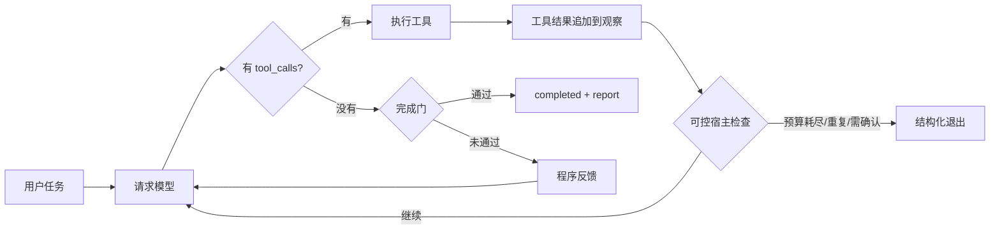

# Agent Loop：从最小循环到可控宿主

这是一份配套技术讲解视频的可运行示例，用「汇总三个部门周报」这个虚构办公任务，演示一个 LLM Agent Loop 是怎样从十几行代码，逐步长成一个可控宿主程序的。

所有 CSV、确认数和归档记录都是**虚构教学数据**。原始输入只读，密钥不会进入仓库，也不会写入运行记录。

## 这套代码演示什么

- **`minimal_loop.py`**：一个真正能跑的最小工具循环。模型返回 `tool_calls` 就执行工具，把结果带原始 `tool_call_id` 回传，再次请求模型；模型不再调用工具时直接返回文本。
- **`loop.py`**：在同样的「模型决策 + 工具执行」之外，增加轮数预算、程序反馈、重复观察检测、完成门、询问用户和结构化退出。
- **`report_service.py`**：真正的业务工具层。负责金额计算、来源覆盖、重复行核对、完成验证；它不决定下一步做什么。
- **`deepseek_model.py`**：DeepSeek Tool Calls 适配层。负责 HTTP 请求、原生调用 ID 关联、响应校验、token 用量和错误记录；它不执行报表业务。

一句话区分职责：

> `deepseek_model.py` 负责「和模型说话」，`report_service.py` 负责「做事」，`loop.py` 负责「决定继续、询问还是停止」。

## 快速开始

要求 Python 3.9+，只使用标准库，不需要安装任何第三方包。

### 离线运行：不需要 API Key

先复制 `fixtures/` 里的虚构 CSV 跑一遍完整场景，使用固定的规则替身做决策：

```bash
python lesson.py --case duplicate
```

一次跑完十种机制场景并执行全部测试：

```bash
python lesson.py --all
```

直接运行测试：

```bash
python -m unittest discover -s . -p "test_*.py" -v
```

离线模式不会请求模型，输出写入 `runs/offline/`。正常重复场景会得到：

- 原始三部门合计：`11500.00`
- 二部 `B202` 重复导出：`2500.00`
- 核对归档并排除派生重复行后：`9000.00`

### 在线运行：调用真实 DeepSeek

复制配置并填入密钥：

```bash
cp .env.example .env
```

编辑 `.env`：

```dotenv
DEEPSEEK_API_KEY=你的密钥
```

然后运行最小循环：

```bash
python minimal_loop.py
```

或运行完整宿主的一个场景：

```bash
python live_run.py --case duplicate
```

整批运行：

```bash
python live_run.py --all --workers 2
```

在线命令会产生 API 用量。运行记录写入 `runs/live/` 或 `runs/minimal/`，这两个目录已被 `.gitignore` 排除。

## 文件作用

| 文件 | 具体作用 |
| --- | --- |
| `minimal_loop.py` | 最小可运行 Agent Loop。核心函数 `minimal_loop()` 只做四件事：请求模型、追加 assistant 消息、执行 `tool_calls`、把工具结果追加回 `messages`。文件后半部分只是运行证据整理，不是循环本身。 |
| `loop.py` | 可控宿主。用 `for _ in range(max_turns)` 替代 `while True`；把程序反馈加入下一轮观察；用 `Counter` 检测重复动作；在 `final` 时检查交付物是否真的通过验证；用 `finish(status, reason)` 统一所有退出。还包含一个固定 Workflow 分支，用来和 Agent 决策模式对照。 |
| `deepseek_model.py` | 模型适配层。定义工具 schema、发送 Chat Completions 请求、校验 `tool_calls` 与参数、维护调用 ID、记录 token 用量和请求耗时。密钥只从环境变量或本目录 `.env` 读取。 |
| `report_service.py` | 报表业务工具。实现 `list_files`、`read_policy`、`read_table`、`build_draft`、`reconcile`、`lookup_order`、`exclude_duplicate`、`validate_report`。金额使用 `Decimal` 计算；排除重复只作用于派生明细；`published_report()` 只有在验证版本与原始文件哈希都未变化时才返回报告。 |
| `report_models.py` | 离线规则替身。只读取工具观察来决定下一步，不访问 `ReportService` 内部状态。支持 `normal`、`premature`、`stuck` 等行为，用于稳定复现边界。 |
| `live_run.py` | 在线场景入口。按 `--case` 或 `--all` 运行真实模型，保存 `trace.json`、`requests.json`、`report.json`、`trace.md` 和批次成绩单。`premature-recovery` 的第一次 `final` 是明确标注的程序故障注入，不冒充模型失误。 |
| `lesson.py` | 离线检查入口。跑十种固定场景，验证每种场景的预期退出状态，并汇总本地测试。不调用真实模型。 |
| `test_report.py` | 16 项业务与边界测试：重复核对、只读输入、冲突、缺表、预算耗尽、重复观察、完成检查反馈等。 |
| `test_minimal_loop.py` | 4 项最小循环测试：工具结果回到下一次请求、一次响应中的多个调用全部执行、最终文本直接返回、默认使用真实模型适配器。 |
| `test_deepseek_model.py` | 8 项协议测试：调用 ID 关联、非法参数、未知工具、截断响应、HTTP 错误、用量统计，以及密钥不进入日志。测试使用假传输，不请求在线 API。 |
| `fixtures/` | 三份虚构部门 CSV 与 `basis.json`。后者保存统计范围、字段映射、部门确认数、上周数和 `B202` 归档依据。 |

没有放入仓库的内容：视频交接包生成、Excel 样表生成等只服务于特定录制流程的脚本。这里保留的是观众复现实验所需的最小完整集合。

## 一次 Agent Loop 如何运行



## 最小循环与可控宿主的差别

| 能力 | `minimal_loop.py` | `loop.py` |
| --- | --- | --- |
| 终止条件 | 模型不再返回工具调用就返回文本 | 显式 `finish(status, reason)` |
| 轮数限制 | 无，`while True` | `max_turns` 预算，耗尽返回 `budget_exhausted` |
| 工具结果 | 原样回传 | 原样回传，并进入统一观察列表 |
| 程序反馈 | 无 | `program_feedback` 与工具结果一样进入下一轮输入 |
| 重复检测 | 无 | 同一观察重复 3 次提醒，4 次返回 `no_progress` |
| 完成判断 | 模型说完成即结束 | 必须通过 `service.published_report()` 验证 |
| 询问用户 | 只靠普通文本 | `ask_user` → `needs_input` |
| 离线可测 | 用假模型传输测试 | 规则替身 + 固定 Workflow，可复现边界 |

最小循环并非「错误实现」。它适合理解骨架，也能在简单任务上完成工作；问题在于它把停止权、完成判断和异常处理全部交给了模型输出。

## 退出状态

| 状态 | 含义 |
| --- | --- |
| `completed` | 业务完成门通过，生成最终报告 |
| `needs_input` | 证据缺失、数据冲突或模型主动询问用户 |
| `no_progress` | 重复动作或连续无效完成提议，主动停止 |
| `budget_exhausted` | 轮数预算耗尽，尚未交付有效结果 |
| `model_error` | 协议、参数、网络或超时错误，不执行未通过校验的工具调用 |

## 可运行场景

在线 `live_run.py` 支持：

| 场景 | 说明 |
| --- | --- |
| `minimal` | 走最小循环，不使用完整宿主 |
| `normal` | 无重复数据，正常完成 |
| `duplicate` | `B202` 重复导出，核对归档后排除派生行 |
| `conflict` | 同一编号的归档证据互相冲突，必须询问用户 |
| `unexplained` | 差额无法解释，不能强行配平 |
| `missing` | 缺少部门表，不能按 0 补齐 |
| `budget` | 两轮预算耗尽，主动停止 |
| `premature-recovery` | 首轮注入错误 `final`，观察完成门拒绝后模型如何继续 |

离线 `lesson.py` 还提供 `premature` 与 `stuck` 两个规则替身场景，用于稳定复现「过早宣布完成」和「重复同一动作」。

## 数据、安全与边界

- 三份 CSV 与归档记录全部是虚构教学数据。
- 原始输入只读；排除重复只修改内存中的派生明细。
- 每次运行都会比较输入文件哈希，确认源文件未被改写。
- API Key 只从环境变量或 `.env` 读取，不接受命令行参数，不写入 trace 或日志。
- 模型适配器只允许 DeepSeek 官方 HTTPS 地址，避免把密钥发往其他主机。
- 请求参数为 `thinking=disabled`、`temperature=0`、`max_tokens=2048`，单次超时 60 秒。

这不是生产级 Agent 框架。权限隔离、持久化恢复、远程写入、自动重试、限流、取消和总费用预算都没有实现。它的目标是让 Agent Loop 的决策、工具、反馈与退出机制可以被完整观察到。

## 测试覆盖

```bash
python -m unittest discover -s . -p "test_*.py" -v
```

共 28 项测试，全部离线运行，不消耗 API。重点验证：

- 工具结果是否使用正确的 `tool_call_id` 回到下一次请求；
- 一次响应中的多个工具调用是否全部执行；
- 完成门拒绝后，反馈是否真的进入下一轮决策；
- 重复观察和预算耗尽是否能停止；
- 原始 CSV 在运行后是否保持字节不变；
- 密钥是否可能出现在请求记录或错误信息中。

## 接口依据

- [DeepSeek Tool Calls](https://api-docs.deepseek.com/guides/tool_calls/)
- [DeepSeek Chat Completions](https://api-docs.deepseek.com/api/create-chat-completion/)
